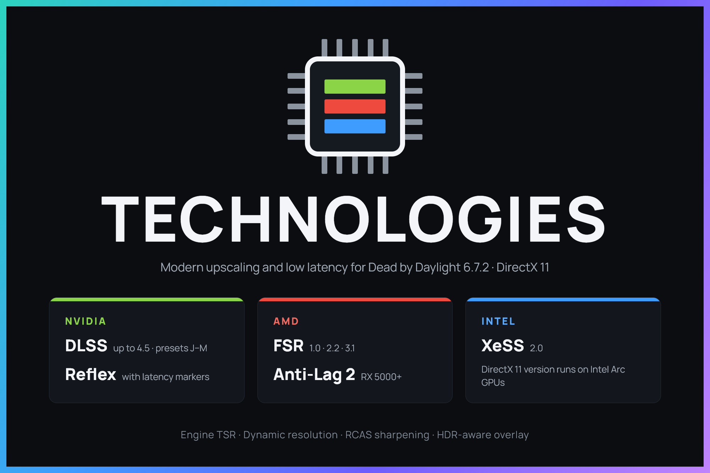

<p align="center"></p>

An `.asi` mod for Dead by Daylight 6.7.2 (UE 4.27, DirectX 11) that adds upscaling and latency technologies the game never shipped with. Everything is off by default and controlled through console variables.

**Engine** — TSR (Unreal's experimental Gen 5 TAAU)<br>
**NVIDIA** — [DLSS](https://github.com/NVIDIA/DLSS) up to 4.5 (RTX), [Reflex](https://github.com/NVIDIA/nvapi)<br>
**AMD** — [FSR 1.0.2](https://github.com/GPUOpen-Effects/FidelityFX-FSR), [FSR 2.2.1](https://github.com/GPUOpen-Effects/FidelityFX-FSR2), [FSR 3.1](https://github.com/GPUOpen-LibrariesAndSDKs/FidelityFX-SDK), [Anti-Lag 2](https://github.com/GPUOpen-LibrariesAndSDKs/AntiLag2-SDK) (RX 5000+)<br>
**Intel** — [XeSS 2.0.2](https://github.com/intel/xess) (Arc only on DirectX 11)

## Install
1. Download the latest release and extract it into `..\DeadByDaylight\Binaries\ASI Mods`.
2. For DLSS, also put the latest `nvngx_dlss.dll` from [TechPowerUp](https://www.techpowerup.com/download/nvidia-dlss-dll/) there.
3. Launch the game and set the console variables below.

## Console variables
```ini
r.Upscaler.Method          ; 0 = TAA/TAAU, 1 = TSR, 2 = DLSS, 3 = XeSS, 4 = FSR 1, 5 = FSR 2, 6 = FSR 3
                           ; FSR 1 needs r.TemporalAA.Upsampling 0, DLSS/XeSS/FSR 2/3 need 1
r.Upscaler.Sharpness       ; 0.0 - 1.0
r.Upscaler.Overlay         ; 0 = off, 1 = on
r.Upscaler.Reset           ; 1 = reset history
r.Upscaler.JitterMode      ; 0 - 3
r.Upscaler.VelocityDecode  ; 0 = linear, 1 = quadratic
r.Upscaler.TargetFPS       ; dynamic resolution: 0 = off, 20 - 500
r.Upscaler.MinResolution   ; 25 - 100 % (default 50)
r.DLSS.Preset              ; 0 = Default, 5 = E, 6 = F, 10 = J, 11 = K, 12 = L, 13 = M
r.LowLatency.Mode          ; 0 = off, 1 = on, 2 = on + boost (NVIDIA)
r.LowLatency.Markers       ; 1 = on (default), 0 = off
```

**DLSS Performance:** `r.TemporalAA.Upsampling 1` → `r.ScreenPercentage 50` (100 = DLAA) → `r.Upscaler.Method 2`

## Build
Visual Studio 2022, **Release | x64**. Rename the output `DBDTechnologies.dll` to `.asi`.

---
**Authors:** [Cranch](https://github.com/Cranch-fur), [Claude](https://claude.com/) · **License:** [GPL v3](LICENSE.txt)
