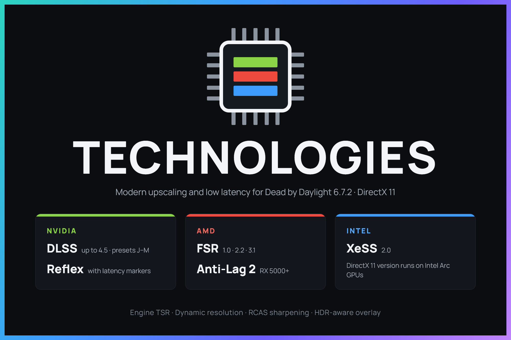

<p align="center"></p>

An `.asi` mod for Dead by Daylight 6.7.2 (UE 4.27, DirectX 11) that adds upscaling, reflection and latency technologies the game never shipped with. Everything is off by default and controlled through console variables.

**Engine** — TSR (Unreal's experimental Gen 5 TAAU)<br>
**Custom** — Voxel reflections: SSR replacement, cone-traced through a voxel cache built from the screen, so off-screen and hidden objects reflect too<br>
**NVIDIA** — [DLSS](https://github.com/NVIDIA/DLSS) up to 4.5 (RTX), [Reflex](https://github.com/NVIDIA/nvapi)<br>
**AMD** — [FSR 1.0.2](https://github.com/GPUOpen-Effects/FidelityFX-FSR), [FSR 2.2.1](https://github.com/GPUOpen-Effects/FidelityFX-FSR2), [FSR 3.1](https://github.com/GPUOpen-LibrariesAndSDKs/FidelityFX-SDK), [Anti-Lag 2](https://github.com/GPUOpen-LibrariesAndSDKs/AntiLag2-SDK) (RX 5000+)<br>
**Intel** — [XeSS 2.0.2](https://github.com/intel/xess) (Arc only on DirectX 11)

## Install
1. Download the latest release and extract it into `..\DeadByDaylight\Binaries\ASI Mods`.
2. For DLSS, also put the latest `nvngx_dlss.dll` from [TechPowerUp](https://www.techpowerup.com/download/nvidia-dlss-dll/) there.
3. Launch the game and set the console variables below.

## Console variables
```ini
r.Upscaler.Method          ; 0 = TAA/TAAU, 1 = TSR, 2 = DLSS, 3 = XeSS, 4 = FSR 1, 5 = FSR 2, 6 = FSR 3
                           ; FSR 1 needs r.TemporalAA.Upsampling 0, DLSS/XeSS/FSR 2/3 need 1
r.Upscaler.Sharpness       ; 0.0 - 1.0
r.Upscaler.Overlay         ; 0 = off, 1 = on
r.Upscaler.Reset           ; 1 = reset history
r.Upscaler.JitterMode      ; 0 - 3
r.Upscaler.VelocityDecode  ; 0 = linear, 1 = quadratic
r.Upscaler.TargetFPS       ; dynamic resolution: 0 = off, 20 - 500
r.Upscaler.MinResolution   ; 25 - 100 % (default 50)
r.DLSS.Preset              ; 0 = Default, 5 = E, 6 = F, 10 = J, 11 = K, 12 = L, 13 = M
r.LowLatency.Mode          ; 0 = off, 1 = on, 2 = on + boost (NVIDIA)
r.LowLatency.Markers       ; 1 = on (default), 0 = off
r.VoxelReflections.Enable        ; 0 = off, 1 = on (needs r.SSR.Quality 1 - 4)
r.VoxelReflections.VoxelSize     ; cm, 2 - 100 (default 8; 4 levels of 128^3, ~96 MB VRAM)
r.VoxelReflections.MaxRoughness  ; 0.0 - 1.0 (default 0.6)
r.VoxelReflections.MaxDistance   ; cm (default 3000)
r.VoxelReflections.Debug         ; 0 = off, 1 = magenta, 2 = normals, 3 = depth, 4 = roughness, 5 = world grid, 6 = voxel cache
r.VoxelReflections.Capture       ; 1 = log the next frame's GPU state, 2 = every draw (DBDTechnologies_Capture_<n>.log)
```

**DLSS Performance:** `r.TemporalAA.Upsampling 1` → `r.ScreenPercentage 50` (100 = DLAA) → `r.Upscaler.Method 2`

## Absolute cinema settings
Built into the game, just switched off.
```ini
r.SSGI.Enable 1                 ; screen-space global illumination
r.SSGI.Quality 4                ; 1 - 4 rays (default 4)
r.SSGI.HalfRes 0                ; 1 = half resolution, faster
r.StaticMeshLODDistanceScale 0  ; static meshes always at full detail (default 1)
r.SkeletalMeshLODBias -10       ; characters at full detail (0 = off)
```

## Build
Visual Studio 2022, **Release | x64**. C++ 20, C Legacy.

---
**License:** [GPL v3](LICENSE.txt)
